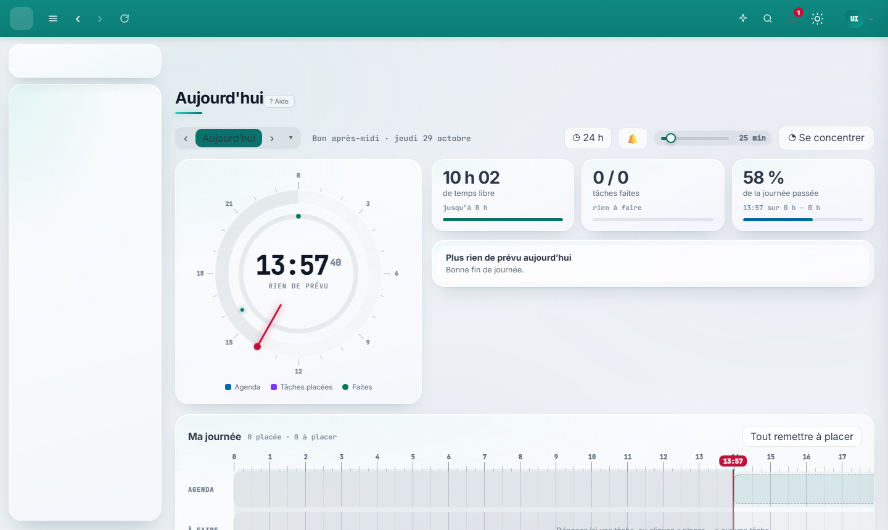
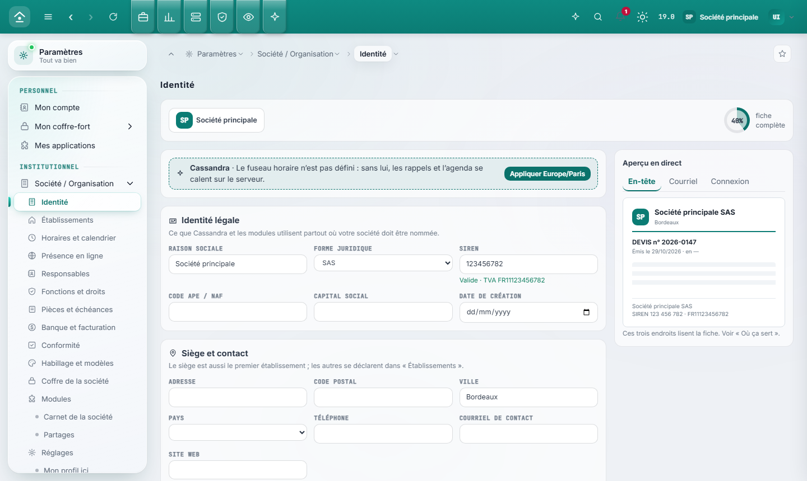
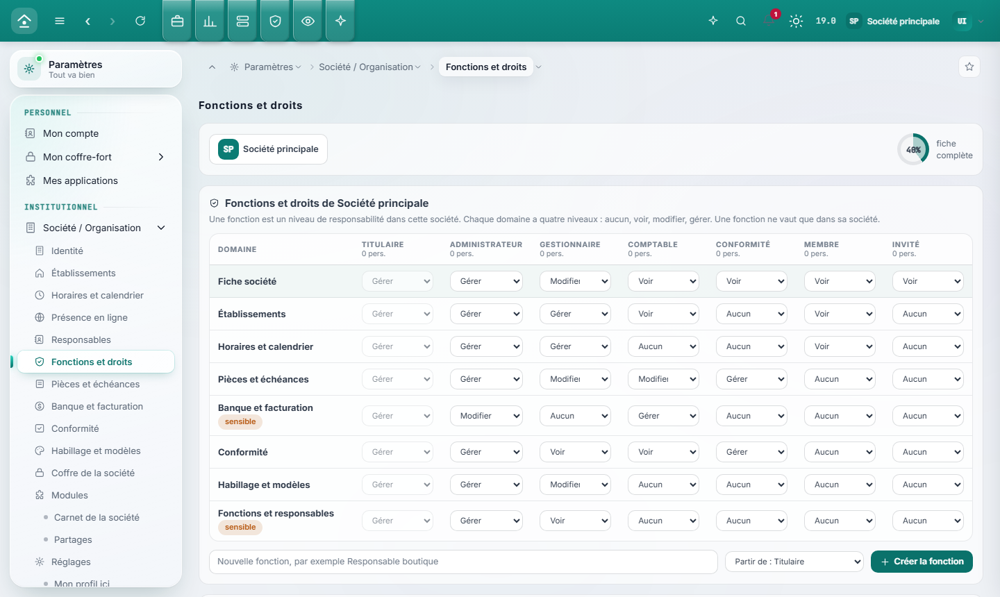
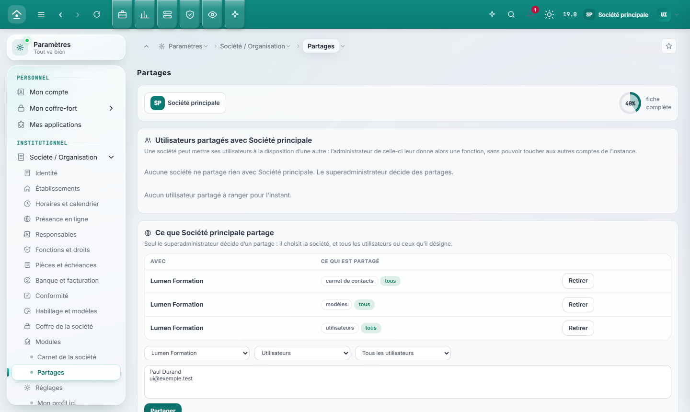
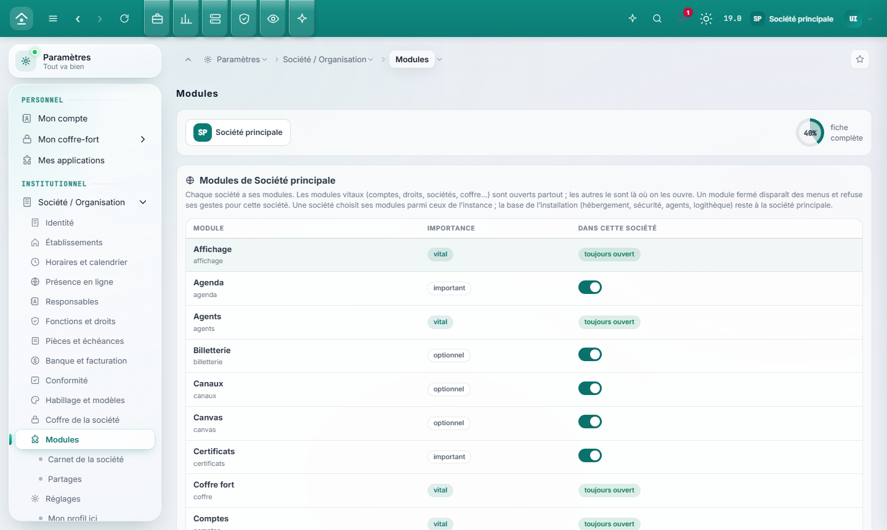

# Cassandra V19

**Cassandra est une IA qui administre vos machines, vos sites et votre travail, avec vous, sans vous attendre.** Elle s'installe sur votre serveur,
reste auto-hébergée (aucun service tiers n'est obligatoire) et se pilote par une interface web.

Concrètement, elle :

- **surveille** la machine et son monde : disque, mémoire, services tombés, certificats qui expirent, sauvegardes absentes ou périmées, DNS qui dérive,
  sites lents ou en panne, ports ouverts, tâches planifiées qui échouent en silence ;
- **comprend** ce qu'elle voit : des anomalies corrélées deviennent *une* histoire (un incident), pas vingt alertes ; elle sait ce qui est normal ce
  jour-là à cette heure, et dit quand une source est **muette** plutôt que de répondre « tout va bien » ;
- **agit** : renouveler un certificat, relancer un service, bannir une adresse, corriger un enregistrement DNS, lancer une sauvegarde, tourner une clé.
  Chaque geste a une **preuve** (elle relit ce qu'elle a fait) et un **retour arrière** (elle sait le défaire) ; sinon il n'existe pas ;
- **se souvenir** : une mémoire de faits datés, prouvés et corrigeables d'une phrase, qui sait dire « je ne sais pas » ;
- **vous seconder au quotidien** : courrier, agenda, tâches, projets, notes, contacts, documents. Tout est à la personne : l'administrateur ne lit
  pas vos notes ni votre boîte mail ;
- **converser** : dans un salon de fils de travail où personnes et agents se parlent, par Telegram, ou à la voix ;
- **tenir un métier** : la billetterie complète d'un lieu ou d'un festival (vente en ligne, caisse, contrôle à l'entrée, revendeurs, artistes,
  commissions, comptabilité), parce qu'une plateforme qui sait agir proprement peut aussi vendre des billets.

Les deux agents ont des rôles distincts. **Cassandra** tient la machine : elle voit, décide et agit. **Itare** tient le bureau de la personne : il lit,
résume, prépare, relance, rédige. Ils s'appuient sur le modèle de langage de votre choix (une clé d'API, un serveur compatible OpenAI, ou Ollama en
local) ; la clé ne sort jamais du module qui la garde.

> **Principe de souveraineté.** Cassandra n'attend jamais un humain. La sûreté ne vient pas d'une permission à demander mais de la **réversibilité** :
> preuve, retour arrière, journal. Un humain agit en voie parallèle, et le noyau le sait. L'administrateur règle jusqu'où l'autonomie va (un palier),
> mais cette prudence est un réglage, jamais un interdit codé en dur.

## Aperçu

L'interface de la V19, sur des données d'essai fictives : le bureau de la personne, puis l'organisation (la société, ses fonctions et leurs droits, ses partages).









## Comment elle travaille

1. **Percevoir.** Des *détecteurs* (chaque module déclare les siens) relèvent des faits ; le collecteur du Sensorium mesure la machine en continu.
2. **Décider.** Un fait qui compte devient un *constat*. Les constats qui reviennent nourrissent le moteur d'évolution ; ceux qui se corrèlent
   forment un incident.
3. **Agir, par un palier.** Une capacité qui écrit a un palier : *raconter* (Cassandra dit ce qu'elle ferait), *auto* (elle le fait, avec preuve et
   retour), *maître* (elle décide aussi des suites). Un geste monte en confiance après dix réussites et retombe après deux échecs de suite.
4. **Prouver.** Le résultat est consigné **avant** sa preuve ; si le processus meurt entre les deux, au redémarrage `reprendre()` prouve ou défait.
5. **Apprendre et raconter.** Tout finit dans le fil (le récit : quoi, pourquoi, avec quelle preuve), que l'utilisateur lit et peut **défaire**.

Quelques règles ne bougent jamais :

- **Ce qui est lu de l'extérieur est une donnée, jamais une consigne.** Un courriel, une page web ou un fichier ne déclenche rien ; après une lecture
  extérieure, ce qui sort de la maison ne part pas seul.
- **L'adresse d'un envoi ne vient jamais de la demande** mais d'un mandat (à qui, quand, combien, sous quel contrôle).
- **Administrer n'est pas voir.** L'administrateur gère les comptes mais ne lit ni les notes, ni l'agenda, ni les projets, ni le courrier des autres.
  Seuls les agents, au nom d'un compte et dans ses droits, voient ce que ce compte voit.
- **Quand des agents agissent au nom d'un compte, ils n'ont pas plus de droits que lui.**
- **Un geste d'urgence est humain** : geler l'autonomie des agents, couper les envois, fermer les sessions, confiner la machine. Aucun n'est un outil
  d'agent, et le confinement se rouvre seul à son échéance.

## Deux sortes de code : le nexus (CN) et l'évolution (EC)

Le projet sépare nettement ce qui doit **rester vrai** de ce qui peut **s'améliorer tout seul**. C'est ce qui permet à Cassandra de se corriger sans jamais
toucher à ce qui protège.

| | **Le nexus (CN)** | **L'évolution (EC, *Evolution Cassandra*)** |
|---|---|---|
| Ce que c'est | ce qui doit rester vrai même si tout ce qui est optimisé se trompe | ce qui peut changer sans que rien de vrai ne change : le *comment* d'un calcul pur |
| Ce qu'il fait | **décide, autorise, agit et prouve** | **calcule**, rien d'autre |
| Ce qu'il couvre | l'identité et l'accès (comptes, droits, cloisonnement, secrets), les effets sur le monde (disque, réseau, base, processus, envois), les données (schémas, migrations, sauvegardes), la preuve (journal, chaîne d'empreintes), l'exploitation (installation, retour arrière, arrêt d'urgence) | l'implémentation d'un **point d'évolution** déclaré par un module : une fonction pure qui respecte son contrat ; aussi les prompts d'agents et les seuils, bornés par le nexus |
| Où il vit | `noyau/` en entier, tous les manifestes, les programmes exécutés en racine, les migrations, les contrats, les tests, les données | dans un fichier **à part**, hors du dossier du module (`/var/cassandra/ec/<module>/`) |
| Qui l'écrit | le dépôt, signé : personne ne le modifie en service | le moteur d'évolution, jamais sans preuve |

**Le test, en six conditions.** Une fonction n'est un point d'évolution que si elle est : **pure** (aucune entrée ni sortie, aucun état), **déterministe** (l'heure et
le hasard arrivent en paramètres), **bornée** (durée et mémoire plafonnées), **mesurable** (une mesure déclarée et un corpus de rejeu), **non décisive** (elle ne
décide d'aucun droit, secret, suppression, envoi ni vérification de preuve) et **contractuelle** (entrée et sortie décrites par un schéma). Sinon, c'est du nexus.
Une fonction pure mais décisive (vérifier une signature, contrôler un droit) reste nexus par défaut ; l'administrateur peut l'ouvrir à l'évolution, sous garde renforcée.

**Comment une EC entre en service, sans pari.**

1. Une variante est proposée (par le moteur d'optimisation, déterministe ou à modèle) pour un point qui coûte cher.
2. Un **évaluateur déterministe**, jamais un modèle qui note son propre travail, la juge sur un **corpus de rejeu** fait d'appels réels, avec une part **réservée**
   que le générateur ne voit pas, et des variantes volontairement fausses pour vérifier que l'évaluateur lui-même n'est pas cassé.
3. Elle tourne **en ombre** à côté de l'actuelle : seules les lectures sont exécutées, les écritures sont détournées vers un simulacre comparé.
4. Elle monte **par paliers** (10 %, 50 %, 100 % du trafic) sur un verdict calculé ; un gain n'est retenu que s'il dépasse 5 % **et** deux fois le bruit de mesure.
5. Un **disjoncteur** la coupe après trois fautes en dix minutes ; le **retour** est instantané (on repasse l'aiguillage) ; une **visite à trente jours** confirme le gain.

**Deux versions par artefact évolutif.** La *version dépôt* (`fastpanel 1.9.0`, signée, personne n'y touche) et la *version EC* (`EC21`, l'état de la ligne évoluée posée
par-dessus), écrites `1.9.0+EC21.a3f9c2` : l'EC ne passe jamais devant le dépôt. Le noyau et le moteur d'optimisation n'ont qu'une version dépôt : ils sont hors évolution.
Chaque fichier le dit dans son en-tête (`ZONE : CN`, `VERSION CN`, `VERSION EC`, `EC LIÉES`) et dans une **borne scellée** que `outils/CN_bornes.py` vérifie.

**Ce qui est vrai aujourd'hui.** Le mécanisme est construit et éprouvé (points d'évolution, corpus de rejeu, évaluateur avec auto-test par mutations, ombre, paliers,
chaîne d'empreintes, module `evolution`), avec `vue` comme premier pilote. Aucune évolution n'a encore été mesurée en production, et l'activer est un choix de
l'administrateur : `docs/CN_EVOLUTION.md` (§ 7) dit l'état exact. La définition et le test sont dans `docs/CN_NEXUS.md`, le format des fichiers dans `docs/CN_FORMAT.md`.

## Installer

Sur un serveur Linux neuf avec systemd (Debian ou Ubuntu de préférence), en root :

```bash
curl -fsSL https://raw.githubusercontent.com/Marplestrange/cassandra-v19/main/CN_amorcer.sh | sudo bash
```

Le script installe ce qui manque (git, python3, curl, `cryptography`, openssl, sudo, cron, iptables, ssh, sshpass, Tailscale ; apt, dnf, yum, zypper,
pacman ou apk), récupère les sources dans `/opt/cassandra-sources`, puis installe le noyau et **tous** les modules. Les bibliothèques de la voix
s'installent avec le module voix.

```bash
... | sudo bash -s -- --module billetterie        le noyau et ce module seulement
... | sudo bash -s -- --racine /srv/cassandra     un autre dossier racine
... | sudo TAILSCALE_AUTHKEY=tskey-... bash       la machine rejoint le réseau Tailscale seule
```

L'application écoute sur `127.0.0.1:9000` : ouvrez-la par un tunnel (`ssh -L 9000:127.0.0.1:9000 utilisateur@serveur`) ou derrière un proxy HTTPS.
**Le premier compte créé sur l'écran de connexion devient le superadministrateur** : créez-le tout de suite.

Mise à jour : relancer la même commande, ou `./CN_deploy.sh` dans `/opt/cassandra-sources`. Une nouvelle version se pose à côté de l'ancienne,
est prouvée, puis la bascule se fait d'un coup ; à la moindre preuve manquante, le retour arrière est automatique.

## Ce que font les modules

Plus de quarante modules, regroupés par famille. Chacun est autonome : on peut n'en installer que quelques-uns.

### Voir : la supervision

| Module | Ce qu'il fait |
|---|---|
| `sensorium` | Les sens de Cassandra : un collecteur à part (service root en lecture, écriture bornée à son dossier) mesure la machine et son monde. Le module en fait des objets `machine`, des constats (un collecteur muet est un constat, pas un silence) et des tuiles. |
| `vue` | La vue d'ensemble : un verdict (rien ne demande un geste / à regarder / en panne), des compteurs, ce qui demande un geste. Une source muette est dite muette. |
| `jour` | Le bureau du jour : ce qui brûle, ce qui est à regarder, ce qui tombe aujourd'hui, assemblé pour la personne qui regarde. |
| `mesures` | L'historique : courbes par période, habitude (ce qui est normal à cette heure), écarts, tendance (date de saturation d'un disque), verdict. |
| `journal` | Le journal des agents (les consultations entre claude, itare et cassandra) et un lecteur unifié des journaux : tables des modules, fichiers système, flux fusionné, ligne du temps, anomalies jamais vues, veilles sur motif. |
| `notifications` | Le Centre de notifications : une notification s'ouvre par clé (elle se répète, ne s'empile pas), est lue **par personne**, et se referme seule quand la cause disparaît. |
| `planifie` | Tout ce qui tourne tout seul sur la machine (tâches de Cassandra, crontabs, cron.d) et si ça va : tâches cassées, en échec ou muettes, verrous, enchaînements, collisions. |
| `flotte` | Le parc de machines : registre déclaré, Tailscale et relevés SSH côte à côte, présence, disponibilité, commandes nommées sur une machine. |
| `proactif` | La Proactivité : autonomie par palier, savoir-faire mesuré, **ombre** (ce qu'elle aurait fait, sans agir), incidents (anomalies corrélées en une histoire), fil (le récit). |
| `evolution` | Le pilotage de l'évolution : quels points méritent d'être optimisés (par ce qu'ils coûtent), proposer une variante, la juger sur un corpus de rejeu, la mettre en ombre, la monter par paliers (10, 50, 100 % du trafic), la retirer d'un geste, vérifier un mois plus tard que le gain tient. |

### Agir : l'hébergement et la sécurité

| Module | Ce qu'il fait |
|---|---|
| `fastpanel` | Le pont vers le panneau FastPanel : lit le parc (comptes, sites, bases, FTP, courrier, DNS, sauvegardes, services), agit par son API (services, certificats, bases, plans de sauvegarde) avec preuve et retour. Surveille les services tombés, les certificats proches de l'échéance, les sauvegardes périmées, les PHP en fin de support. |
| `sites` | Les sites suivis par compte : une sonde chronomètre chacun (code, durée, certificat) et garde l'historique ; panne, retour, lenteur, certificat court font des constats. L'administrateur voit l'état de tous, jamais le contenu. |
| `dns` | Relève les zones auprès de leur serveur de noms faisant foi, garde une référence versionnée, signale la dérive, l'adresse publique qui change, les domaines proches de l'expiration ; corrige un enregistrement A chez Cloudflare et le prouve. |
| `certificats` | Surveille les certificats TLS réellement servis, tient le registre Let's Encrypt (quota par domaine) et signale les échéances. |
| `sauvegardes` | Les plans (un site ou une base passe par FastPanel, le reste par rclone), la rotation par dossiers datés, la vérification par échantillon, la couverture. |
| `securite` | Les gestes (bannir une adresse, fermer un chemin, tourner une clé), le journal de ce qui a été fait, les audits (Lynis, Trivy, ClamAV, CrowdSec), le pare-feu. |
| `urgence` | Geler l'autonomie des agents, couper les envois, fermer les sessions des autres, lever la crise du noyau, **confiner** la machine (SSH par mot de passe coupé, réseau fermé sauf à votre session, avec une échéance qui rouvre seule). |
| `coffre` | Le magasin de secrets (Vaultwarden, compatible Bitwarden) : un espace par compte et par société, un rôle par secret, l'auteur de chaque secret ; lecture, écriture réversible, retrait. |
| `webauthn` | Clés de sécurité en second facteur (avec huit codes de secours) ou connexion sans mot de passe par clé d'accès. |

### Travailler : le bureau de la personne

| Module | Ce qu'il fait |
|---|---|
| `courrier` | La boîte mail par IMAP : dossiers, lecture d'un HTML nettoyé par liste blanche (rien ne s'exécute, aucune image distante sans accord), gestes réversibles, brouillons ; l'envoi SMTP est réservé à un humain. Les identifiants sont chiffrés, par compte. |
| `agenda` | Événements, récurrences, rappels, import et export iCalendar, lecture CalDAV, et une vue unique qui rassemble événements, tâches datées, rappels et jalons de projets. |
| `taches` | Statut, échéance, priorité, sous-tâches, récurrence, responsable (soi, un membre du projet, ou Itare), liens, journal de chaque mouvement, provenance. |
| `projets` | Fiche (objectif, périmètre, critères de réussite), phases, jalons, décisions, journal daté, plan de référence qui rend le glissement visible, équipe avec rôles. |
| `notes` | Numéros stables (N-0007, jamais réattribués), renvois et rétro-liens, dossiers, versions à chaque écriture, cases liées aux tâches, note du jour, liens de partage qui expirent. |
| `canvas` | Le canvas de notes : des départs (gabarits), des gestes de rédaction, un plan de cartes et de flèches. Il propose, l'écran montre, la personne décide. |
| `contacts` | Le carnet : fiches, dossiers, corbeille de trente jours, doublons et fusion (jamais d'office), vCard et CSV. Un modèle ne reçoit les coordonnées que si l'administrateur l'a choisi. |
| `ged` | La gestion documentaire : sources, index, règles de classement, aperçu en ligne (liste blanche stricte), corbeille. |
| `memoire` | La mémoire de Cassandra : un souvenir est un fait daté, prouvé, propriétaire, corrigeable d'une phrase. Une seule porte d'écriture avec ses gardes (secret, consigne, données sensibles, quotas), versions liées, veto pour les écritures critiques, doutes posés à l'humain, rappels conditionnés aux capteurs, journal chaîné par empreintes. Un état se mesure, il ne se rappelle pas. |

### Échanger : les conversations

| Module | Ce qu'il fait |
|---|---|
| `salon` | Des fils de travail où personnes et agents se parlent. Adresser un agent résident le fait répondre dans le fil, un tour à la fois, avec un budget qui borne la conversation d'agents entre eux. |
| `agents` | Cassandra et Itare en conversation. Un tour lit la mémoire, raisonne par un modèle, appelle des **outils dérivés du catalogue** (une capacité de plus = un outil de plus) et conclut en clair. Un outil « raconté » n'a rien fait, et l'agent le dit. |
| `modeles` | Le registre des modèles de langage : un modèle se déclare une fois (fournisseur, nom, adresse, clé chiffrée). Un compte n'utilise que **ses** modèles, jamais la clé du serveur. |
| `mandats` | Les autorisations d'envoi, avec leurs bornes. |
| `telegram`, `canaux` | Un robot Telegram par compte, qui porte les notifications de CE compte vers SON téléphone et ne lit rien de ce qu'on lui écrit. Le miroir des conversations est éteint par défaut, délibérément. |
| `voix` | La dictée (faster-whisper) et la lecture (piper), avec un choix de voix par compte. |

### Le socle

| Module | Ce qu'il fait |
|---|---|
| `comptes` | Identifiant (une adresse e-mail), mot de passe (scrypt salé), sessions, jetons de mise en place. |
| `droits` | Qui peut utiliser quoi : les modules déclarent leurs droits, on les attribue à des comptes et des groupes. |
| `societes` | Les sociétés de l'instance et leur fiche (identité, siège, banque, conformité, habillage, responsables). Tout compte appartient à une société. |
| `reglages` | Les réglages que chaque module déclare, écrits un par un avec leur historique ; les secrets ne sortent jamais en clair. |
| `menus`, `affichage`, `themes` | L'interface s'assemble à chaud à partir de ce que les modules actifs déclarent : menus, tuiles, gabarits, deux thèmes complets livrés comme des modules. |
| `modules` | La Logithèque (ci-dessous). |

### Les métiers

| Module | Ce qu'il fait |
|---|---|
| `billetterie` | La billetterie complète (ci-dessous). |
| `dolibarr` | Un pont vers une instance Dolibarr par son API REST : lit (santé, comptes, impayés, objets) et agit (tiers, contacts, produits, brouillons de documents), avec preuve et retour ; supprimer passe par une corbeille. Facultatif. |

## Le coffre : Vaultwarden, compatible Bitwarden

Cassandra ne réinvente pas le coffre-fort. Les secrets (clés d'API, mots de passe de boîtes, jetons) vivent dans **Vaultwarden**, une implémentation libre et légère
du serveur **Bitwarden**, que vous hébergez vous-même. Aucun secret n'est gardé en clair ni dans la mémoire de Cassandra, ni dans ses journaux, ni dans le code : un module
qui a besoin d'une clé la demande au coffre.

- **Comment elle lui parle.** Le module `coffre` dialogue avec le client en ligne de commande de Bitwarden, lancé en `bw serve` (une API REST locale, par défaut
  `http://127.0.0.1:8087`, réglable), déverrouillé sur le même serveur. Chaque secret est une **note sécurisée** nommée `espace::nom`. Une liste ne rend jamais que les
  noms, jamais les valeurs ; chaque lecture est inscrite au journal du coffre ; chaque écriture a sa preuve (relue) et son retour arrière.
- **Qui voit quoi.** Vaultwarden n'ouvre ici qu'une session de service : l'isolement est tenu **par le module**, dans sa propre base. Un compte ne voit que son coffre ;
  chaque société a le sien, avec des rôles (administrateur du coffre, membre, contributeur, lecture), des collections, une date de fin d'accès, et l'auteur de chaque
  secret : un contributeur écrit mais ne relit que les siens. Ni l'administrateur de l'instance, ni Cassandra, ni l'administrateur d'une société ne lit un espace dont
  il n'est pas membre. Les secrets ne se consultent donc pas compte par compte avec les applications Bitwarden : l'accès normal passe par Cassandra.
- **Un coffre par société, sur son propre serveur.** L'espace d'une société peut être *externe* : ses secrets vivent sur le Vaultwarden de la société (un `bw serve`
  déverrouillé), à l'adresse que lui donne l'administrateur de l'instance. S'il est injoignable, rien n'est lu ni écrit et rien ne se replie sur le serveur de l'instance.
- **Quand quelqu'un part.** Un compte désactivé ou supprimé perd à l'instant l'accès aux espaces de société ; son coffre personnel reste le sien. Le dernier administrateur
  d'un espace ne part pas : le journal du coffre le dit, et il faut en nommer un autre.
- **À installer à part.** Vaultwarden et le client `bw` sont des produits tiers, sans affiliation avec Cassandra. Les réglages du module sont `coffre.vault_url` et
  `coffre.vault_timeout` ; sans coffre joignable, le module le dit (statut « indisponible ») et ce qui a besoin d'un secret s'arrête, proprement.

Le détail (rôles, collections, espace externe, départ) est dans `docs/CN_SOCIETES.md`.

## Plusieurs sociétés dans une même instance

Une instance peut porter plusieurs organisations, à la façon de Dolibarr (Multicompany), avec une règle qui simplifie tout : **la société principale est
propriétaire de l'instance**. Seule elle décide du comportement de l'application ; les autres travaillent dedans.

- **Tout compte appartient à une société.** Ses répertoires et documents vivent dans le grand répertoire de sa société. Un utilisateur peut aussi avoir une
  fonction dans d'autres sociétés, sans y être administrateur. Un sélecteur à côté de l'avatar met toute l'application dans la société choisie.
- **Des fonctions, pas des rôles figés.** Sept fonctions de départ (titulaire, administrateur, gestionnaire, comptable, conformité, membre, invité), un niveau par
  domaine (aucun, voir, modifier, gérer), d'autres à créer. Une fonction ne vaut que dans sa société.
- **Chaque société a ses modules.** Les modules vitaux sont partout ; les autres s'ouvrent société par société. La base de l'installation (sécurité, sauvegardes,
  agents, logithèque) reste à la société principale. Une société secondaire n'installe rien : elle **demande** un module, la principale l'examine, l'installe puis l'attribue.
- **Des données séparées.** Un module peut déclarer une **base par société** : son code ne change pas, ses données et ses moteurs suivent la société de l'acte.
- **Un coffre isolé.** Un compte ne voit que son coffre ; chaque société a le sien (rôles administrateur, membre, contributeur, lecture ; chaque secret garde son auteur).
  Le coffre d'une société peut vivre sur **son propre serveur Vaultwarden**, dont l'adresse n'est fixée que par l'administrateur de l'instance.
- **Des partages décidés par le superadministrateur** : les utilisateurs d'une société mis à la disposition d'une autre, son carnet de contacts (en lecture seule,
  sans les notes), ses modèles (habillage, préfixes de devis et de facture : jamais la banque).
- **Un profil par société.** La même personne signe et se présente différemment dans chacune ; la signature du courrier le reprend.
- **Une vue consolidée** pour le superadministrateur : utilisateurs, modules ouverts, partages et demandes en attente, société par société.

Le détail est dans `docs/CN_SOCIETES.md`.



## La billetterie, de bout en bout

Le titulaire de l'instance est l'organisateur. L'argent est tenu **en centimes**, dans un registre **en écriture seule**.

- **Événements** : salles, quotas, tarifs, formules, retenues de places, liste d'attente, annulation et remboursements.
- **Vente en ligne** : une boutique publique sans compte obligatoire, avec paiement Stripe, PayPal ou HelloAsso, conditions de vente acceptées et
  versionnées, billets signés (HMAC) avec QR code, reçus et billets en PDF envoyés par courriel.
- **Caisse** : vente au guichet qui continue **hors ligne** et se synchronise au retour du réseau.
- **Contrôle à l'entrée** : lecture des QR par la caméra du téléphone, hors ligne aussi, anti-doublon.
- **Revendeurs et artistes** : chacun a son espace, son profil (coordonnées, SIRET, IBAN vérifié et chiffré), ses ventes, son solde et ses demandes
  de retrait ; les commissions sont calculées par formule et versées avec preuve.
- **Comptes clients** : connexion par lien magique, historique des commandes, suppression différée de son compte.
- **Gestion** : rentabilité d'un événement, projet et tâches créés depuis l'événement, pont comptable (factures, avoirs, versements) vers
  Dolibarr si on l'utilise.
- **Itare** peut tout lire de ce domaine et préparer des gestes ; les écritures passent par les mêmes paliers que le reste.

Détail et décisions : `docs/CN_BILLETTERIE.md` (le §21 dit ce qui est construit et ce qui ne l'est pas).

## La Logithèque : le magasin d'applications

Une page (menu de l'avatar) où se gèrent les modules, leurs sources, leur sécurité et l'autonomie de Cassandra sur eux. Pour un compte ordinaire :
**Mes applications**. Elle remplace l'ancienne page des modules (`docs/CN_LOGITHEQUE.md`).

- **Vue d'ensemble, Installés, Mises à jour, Boutique, Sources, Sécurité et confiance, Santé, Journal.** Un module montre ses dépendances, ses
  permissions, sa santé et ses versions avant tout geste.
- **Cassandra gère les modules seule** (`docs/CN_AUTONOMIE_MODULES.md`). La page lui laisse l'initiative et montre à l'utilisateur ce qu'elle a fait,
  avec le pourquoi. L'utilisateur peut tout **défaire**, la mettre en **pause**, **verrouiller** un module ou lui **demander** quelque chose.
  Les gestes directs sont derrière un Mode avancé, et leur impact se dit avant.
- **Le niveau d'autonomie est le choix de l'administrateur**, jamais un interdit codé.
- **Les modules viennent d'un registre** (le registre officiel, verrouillé et daté, ou un autre que l'administrateur ajoute) et se livrent en
  **paquets** `.cmod` : empreinte de chaque fichier, signature Ed25519 de l'éditeur, extraction sûre. L'administrateur déclare les éditeurs de
  confiance par leur clé publique (`config/cles/`) ; un paquet falsifié, d'un éditeur inconnu ou dangereux est refusé. Les **permissions** d'un module
  sont dites avant son installation. Le noyau ne se fie jamais au store : il revérifie tout (`docs/CN_STORE.md`).
- **Écrire un module** : `docs/CN_MODULES_DEVELOPPEUR.md` (le manifeste, `brancher(ctx)`, les capacités, les migrations, le paquet).

```
python CN_main.py module liste                        un module par ligne : famille, état, version
python CN_main.py module activer ID                   active d'abord ses dépendances
python CN_main.py module desactiver ID [--en-cascade]
python CN_main.py paquet construire DOSSIER --cle PRIVEE.pem     un paquet signé, reproductible
python CN_main.py paquet verifier ARCHIVE
```

Activer ou désactiver un module change le menu et les fonctions **à chaud**, sans redémarrer. Désactiver n'efface rien : objets, événements et
savoir-faire du module restent. Un module qui a des scripts d'installation ne s'active que s'il est installé (`CN_install.sh --module ID`), car le
noyau tourne sans privilège.

## Les quatre enjeux du moteur

| Enjeu | Ce que le moteur fait |
|---|---|
| **Modularité** | Manifeste validé (objets, événements, capacités, détecteurs, écrans, installation). Ordre d'installation par dépendances, cycles refusés. Un module n'en importe jamais un autre. |
| **Sécurité** | Une écriture déclare périmètre, preuve et retour arrière, sinon le manifeste est refusé. Acteurs autorisés par capacité, refus journalisés. En crise, seule la lecture passe. Cloisonnement par compte et par société. |
| **Évolution** | Les constats qui reviennent sont la matière du moteur d'évolution. Le palier d'une capacité monte (10 réussites) et redescend (2 échecs). Versions de manifeste et `noyau_min`. |
| **Résilience** | Connexions SQLite courtes, écritures qui réessaient. Le résultat d'une écriture est consigné avant sa preuve : au redémarrage, `reprendre()` prouve ou défait. Un détecteur en panne se voit toujours. |

## Les pièces du noyau

```
CN_main.py                  le moteur central : assemble le noyau et fait battre le cycle (percevoir, décider, agir, prouver, apprendre)
noyau/CN_manifeste.py       le contrat d'un module (lecture, validation, ordre d'installation)
noyau/CN_base.py            SQLite : connexions courtes, BEGIN IMMEDIATE avec reprises
noyau/CN_bus.py             le bus d'événements, la lignée, le cloisonnement par portée
noyau/CN_registre.py        le registre des objets, un propriétaire par type
noyau/CN_catalogue.py       le catalogue des capacités et le savoir-faire (paliers raconter / auto / maitre)
noyau/CN_executeur.py       la seule porte d'exécution : droits, palier, preuve, retour arrière, apprentissage
noyau/CN_contexte.py        ce qu'un module voit du noyau, et rien d'autre
noyau/CN_chargeur.py        découverte, isolation, branchement dans l'ordre des dépendances
modules/<id>/               CN_manifeste.toml, CN_module.py (def brancher(ctx)), migrations, scripts d'installation
interface/                  l'interface web, assemblée à partir de ce que les modules déclarent
tests/ , tests-ui/          les bancs (unittest) et les essais de l'interface (Playwright)
```

## Utiliser en développement

Python 3.11 ou plus, et la bibliothèque `cryptography`.

```
python CN_main.py verifier       manifestes, isolation, ordre d'installation, capacités à porter
python CN_main.py etat           résumé du noyau
python CN_main.py tick           une passe de détection
python CN_main.py demarrer       le cycle en continu (interface sur le port 9000)
python -m unittest discover -s tests -p "CN_test*.py" -v
```

Les données vont dans `donnees/` (ou `$CASSANDRA_DONNEES`).

## Les moteurs : le noyau les ordonnance

Une boucle ou une passe qui tourne seule se déclare au manifeste (`[[moteurs]]`) et s'inscrit par `ctx.moteur(id, fonction)`. Le module n'ouvre
jamais de thread : le noyau l'exécute dans un fil surveillé.

| Mode | Se réveille | Exemple |
|---|---|---|
| `periodique` (`toutes_les_s`, 10 s minimum) | à intervalle | mesurer le disque |
| `evenement` (`sur`, un type écouté par le module) | quand l'événement paraît, avec la lignée | réagir à un certificat renouvelé |
| `demande` | seulement si un humain ou un agent le lance | un export |

Pour chaque moteur, le noyau mesure la durée, empêche qu'il s'empile s'il dépasse `duree_max_s` (il est alors dit « figé »), compte les échecs, les
dit au bus et le suspend après cinq échecs de suite. `python CN_main.py moteurs` les liste avec leur état.

## Les droits : déclarés par les modules, vérifiés en un seul endroit

Un module **déclare** ses droits ; une capacité, une entrée de menu ou une tuile y renvoie par `droit = "..."`. Le module `droits` les attribue à des
**comptes** et à des **groupes** ; l'exécuteur les vérifie, et lui seul. Un module qui ne déclare pas ses droits est refusé à l'installation.

```toml
[[droits]]
id = "ecrire"
libelle = "Écrire en compta"
sensible = true            # signalé à celui qui l'attribue

[[capacites]]
id = "passer_ecriture"
droit = "ecrire"           # devient « compta.ecrire »
```

Résolution, du plus fort au plus faible : administrateur › accord ou refus propre au compte › refus d'un groupe › accord d'un groupe › défaut du
droit › non. Quand Itare ou Cassandra agissent **au nom d'un compte**, ils n'ont pas plus de droits que lui. Sans compte (infrastructure, agents
seuls), aucun droit n'est demandé : c'est le **palier** de la capacité, réglé par l'administrateur, qui les borne. Un refus est un événement
(`capacite.refusee`, avec le droit et la raison), et le menu se filtre par droits.

```
python CN_main.py agir droits.regler sujet=sandrine droit=compta.ecrire
python CN_main.py agir droits.groupe groupe=compta libelle=Comptables
python CN_main.py agir droits.membre compte=jules groupe=compta
python CN_main.py agir compta.passer_ecriture --compte sandrine        essayer comme elle : refusé, avec le droit manquant
```

Les comptes, les sociétés (tout compte appartient à une société), les fonctions et le coffre isolé par espace : `docs/CN_UTILISATEURS.md`,
`docs/CN_SOCIETES.md`.

## Les menus : un module déclare, le noyau assemble

```toml
[[menus]]
id = "domaines"          libelle = "Domaines"      ecran = "vue_domaine"
ordre = 10               role = "admin"            icone = "globe"
parent = ""              badge = "constats"
```

Le module `menus` (essentiel) assemble l'arbre : familles, entrées des modules actifs, enfants, filtré par rôle et par droits. Il se rebâtit dès
qu'un module est branché ou débranché. Masquer, renommer, réordonner ou déplacer une entrée se fait pour tous ou pour un compte, par la capacité
`menus.personnaliser_entree` (avec preuve et retour arrière). L'apparence (thèmes, tuiles, gabarits) s'assemble de la même façon
(`docs/CN_AFFICHAGE.md`).

## Les agents : Cassandra, Itare et le palier

Une capacité qui écrit a un **palier** : *raconter* (l'agent dit ce qu'il ferait), *auto* (il le fait, avec preuve et retour), *maître* (il décide
des suites). Le palier monte avec les réussites et redescend avec les échecs ; le plafond est le choix de l'administrateur.

```
python CN_main.py palier                              les capacités qui écrivent, leur palier, les paliers permis
python CN_main.py palier dolibarr.supprimer auto      Cassandra supprime seule (avec corbeille)
```

Les gestes d'urgence (`urgence`) gèlent l'autonomie des agents : ils observent, n'agissent plus.

## Greffer un module après coup

1. **Un module livré avec le noyau** : on ajoute `modules/<id>/` au dépôt ; `CN_deploy.sh` le pousse (inactif) ; `CN_install.sh --module <id>` l'installe.
2. **Une extension, à chaud** : `CN_install.sh --extension ./mon_module` (ou un paquet `.cmod`). Copiée dans `extensions/` (que `CN_deploy.sh`
   ne touche jamais), vérifiée, prouvée, puis **branchée sans redémarrer**. Exemple : `exemples/sentinelle/`.
3. **Un moteur de plus sur un module existant**, sans le modifier : une extension qui écoute ses événements.

Une extension qui porte l'identifiant d'un module livré **le remplace** ; le module livré est mis de côté, pas perdu, et reprend sa place si le
remplaçant est écarté. Seul l'administrateur peut décider de remplacer un module essentiel. Une extension illisible, qui importe un autre module ou
dont une dépendance manque est écartée et dite une fois au bus, sans jamais empêcher le noyau de démarrer.

Un module tourne aujourd'hui dans le processus du noyau : c'est un niveau de confiance « local ». Un module de tiers non fiable exigera une cage
par processus (à construire, voir `docs/CN_STORE.md`).

## Où vit Cassandra

```
/var/cassandra/                 UN seul dossier : on le sauvegarde, on le déplace d'un bloc (CASSANDRA_RACINE)
    releases/<horodatage>/      les versions du noyau ; l'ancienne reste à côté pour le retour arrière
    current -> releases/...     lien relatif
    extensions/                 les modules greffés (un déploiement n'y touche jamais)
    donnees/                    la base du noyau et ses sauvegardes
    config/                     la configuration, les clés publiques des éditeurs, l'unité systemd
    journal/

/var/www/<utilisateur>/data/    le dossier d'un utilisateur (compatible avec FastPanel)
    cassandra/                  son espace Cassandra
```

Le premier administrateur est `fastuser` (`--admin NOM` pour un autre nom). Un module demande l'espace d'un utilisateur par `ctx.espace(utilisateur)`
et ne sort jamais de `/var/www/<utilisateur>/data/cassandra/<module>`. La disposition est décrite une seule fois, dans `exploitation/CN_commun.sh`.

## Exploitation

```
./CN_install.sh                          le noyau seul : utilisateur, dossiers, version, service systemd
./CN_install.sh --tous                   + tous les modules du dépôt
./CN_install.sh --module certificats     + ce module et ses dépendances ; chacun s'installe par SON script,
                                         se prouve par SA vérification, se retire seul si la preuve manque
./CN_install.sh --retirer certificats
./CN_deploy.sh [--a-blanc]               mise à jour : nouvelle version à côté de l'ancienne, bancs, sauvegarde de la base,
                                         bascule atomique, preuve de chaque module actif qui a changé, retour arrière seul
outils/CN_pousser.sh <hote> install|deploy [options]    envoie l'arbre par SSH et lance le script là-bas
```

Le noyau tourne en service `Type=notify` : il annonce qu'il est prêt, puis donne signe de vie ; systemd tue et relance une boucle figée
(`WatchdogSec=120`). L'unité est durcie au plus étroit (utilisateur dédié, système en lecture seule, aucune capacité, appels système filtrés). Un
module qui a besoin de plus ouvre exactement ce qu'il lui faut dans un drop-in nommé, posé par son `CN_installer.sh` et retiré par son `CN_retirer.sh`.

## Où en est le portage, honnêtement

La V19 reprend la V18 module par module, sans la réécrire à l'aveugle. Tous les modules ci-dessus sont portés et testés (des bancs par module, plus
des essais d'interface par navigateur), mais le portage est fait par couches : le **cœur** d'abord, puis ce qui demande des droits système.

- Ce qui touche la machine en root (exécuter rclone, lancer Lynis ou ClamAV, poser le pare-feu, télécharger les modèles de voix) passe par un
  **courtier racine** : le noyau ne dit jamais *quoi* exécuter, seulement *quelle commande nommée* d'un module. Plusieurs de ces exécutions sont
  encore à brancher ; la description de certains manifestes le dit (« Différé »), et `CN_BILAN-V19.md` tient la liste ; ces mentions peuvent dater.
- Les services externes (Stripe, PayPal, HelloAsso, SMTP, Dolibarr, FastPanel) sont testés contre des doublures et des serveurs locaux, pas encore
  contre les vrais services : le premier essai réel est à faire avec vos propres clés.
- Un module de **tiers** ne peut pas encore être confiné dans son propre processus ; en attendant, n'installez que des paquets d'éditeurs de
  confiance (voir `docs/CN_STORE.md`).
- Pas encore construit : les cartes Apple Wallet et Google Wallet de la billetterie (elles demandent un certificat et une clé de service).

## L'histoire : de la V18 à la V19

Cassandra est devenue un monolithe : `cassandra.py` en V18, plus de 150 000 lignes, un agent d'administration système
auto-hébergé (voir le dépôt [Marplestrange/cassandra](https://github.com/Marplestrange/cassandra), où l'historique de toutes les versions est conservé).
Il a fait ses preuves en production, mais un seul fichier ne se prête ni à l'ouverture à d'autres, ni à l'évolution contrôlée, ni à la sécurité par
périmètre. La V19 en tire un **noyau** qui ne connaît aucun métier, et des **modules** qui se déclarent par un manifeste. Les leçons de la V18 (un
réglage qui disparaît parce que la sauvegarde réécrit tout le fichier, un cache qui survit au processus et défait le cloisonnement, une panne
muette qu'on prend pour une absence) sont devenues des règles du noyau.

## Pour aller plus loin

`CN_BILAN-V19.md` (où en est le portage), puis `docs/` :

| Document | Sujet |
|---|---|
| `CN_MODULES_DEVELOPPEUR.md` | écrire un module : manifeste, `brancher(ctx)`, capacités, migrations, paquet |
| `CN_LOGITHEQUE.md`, `CN_STORE.md`, `CN_AUTONOMIE_MODULES.md` | le magasin d'applications, la chaîne de confiance, l'autonomie sur les modules |
| `CN_BILLETTERIE.md` | la billetterie : conception, registre, paiements, ce qui est fait |
| `CN_UTILISATEURS.md`, `CN_SOCIETES.md` | comptes, groupes, sociétés, coffre isolé par espace |
| `CN_EVOLUTION.md` | le moteur d'évolution : rejeu, ombre, paliers, retrait |
| `CN_AFFICHAGE.md`, `CN_REGISTRE.md`, `CN_FORMAT.md` | l'interface assemblée, le registre des objets, le format des fichiers |

## Contribuer et signaler une faille

La V19 est faite pour les contributions : un module est un dossier indépendant, avec son manifeste, ses droits et ses tests. Le guide est dans
[`CONTRIBUTING.md`](CONTRIBUTING.md). Une faille se signale en privé, avant toute publication : voir [`SECURITY.md`](SECURITY.md).

## Qui porte le projet

Cassandra est portée par **La Maison Bohème**, association loi 1901 (SIREN 899 553 093, RNA W751260323), qui accepte les dons. Les dons ouvrent
droit à une réduction d'impôt de 66 % de leur montant, dans les limites fixées par la loi. Pour soutenir le projet, écrivez à
marplestrange@cassandra.center.

## Licence

AGPL-3.0. Auteur : Atek Drisse, github.com/Marplestrange.
